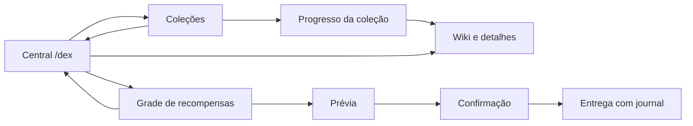

# Layout Shirokai — primeira passagem

Prioridade atual do responsável: melhorar o layout geral antes de avançar nos demais sistemas. `/dex` abre uma central de seis linhas, com título em gradiente, destaques ✦, fundo discreto, resumo real do treinador e atalhos. Coleções continuam em três linhas; wiki em quatro; recompensas agora têm grade paginada em três linhas. Não mudamos os comandos diretos de coleções existentes nem criamos aliases que possam mascarar IDs personalizados.

| Botão da central | Slot padrão (base zero) | Estado |
|---|---:|---|
| Resumo do treinador | 4 | Nome e progresso oficial; informativo |
| Pokédex | 20 | Seletor de coleções autorizadas |
| Recompensas | 22 | Grade/páginas/prévia/confirmação |
| Wiki | 24 | Coleção nacional, se autorizada |
| Competições | 29 | Em desenvolvimento, sem ação |
| Conquistas | 31 | Em desenvolvimento, sem ação |
| Histórico | 33 | Em desenvolvimento, sem ação |
| Preferências | 40 | Em desenvolvimento, sem ação |
| Voltar ao menu externo | 48 | `/menu` como jogador, se registrado |
| Fechar | 50 | Fecha a interface |

O resumo não inventa dinheiro, capturas, rankings ou placeholders externos. “Marco desbloqueado” é um marco observado, não uma declaração de que já foi/será entregue; journal continua controlando o resgate. Áreas sem sistema pronto são explicitamente desativadas. O retorno interno “Central Shirokai” é diferente do botão externo VOLTAR AO MENU.

```json
"home": {
  "rows": 6,
  "palette": "VIOLET",
  "slots": {"dex": 19}
}
```

Opções: VIOLET (padrão), OCEAN, EMBER. rows aceita 3..6; posições omitidas herdam padrões. Para reduzir linhas, reposicionar todos os botões que sairiam do tamanho. IDs desconhecidos, posições duplicadas/fora da grade, campos duplicados e comandos arbitrários no layout são rejeitados integralmente; reload mantém estado/backup válido. Configuração antiga sem home continua válida.

Botões/decoração não transferem itens ao inventário; callbacks verificam permissões atuais. /menu usa a fonte do próprio jogador sem elevar permissão; se o comando não existir, o botão informa indisponibilidade e não executa um comando presumido.

## Navegação atual



Esta é a primeira passagem, não a conclusão de todos os layouts JSON do prompt. Próximo bloco: harmonizar páginas de progresso, wiki/detalhes/formas/spawn e prévia/confirmação; revisar ícones/lore e espaço; incluir estado real de resgate na apresentação e melhorar perfil/placeholder quando houver integração. Evitar retomar moeda/Crates/competições antes dessa revisão visual, conforme prioridade do usuário.

[Evidência de protocolo](validation/layout-home.json). Gradientes/slots/navegação foram validados no protocolo; aparência final em cliente Minecraft real e carga ainda não certificadas. Probes de teste não integram o JAR distribuído.

## Submenus — segunda passagem local

`MenuStyle` aplica títulos em duas cores, cartões ✦, lore legível e rodapés nas posições livres, preservando controles. A barra de 12 segmentos usa contagem exata e não aparece para dados desconhecidos/vazios; nunca fica cheia antes de 100% real.

Prévia e grade leem estados persistidos via worker SQLite, sem reservar operações. Leituras falhas mostram indisponibilidade e não oferecem resgate. Prévia distingue reserva com plano alterado e permite consultar o UUID completo no chat. Callbacks verificam sessão, tela, configuração e permissões antes de abrir. Os ícones de payload e o item da confirmação preservam componentes próprios. Confirmação inclui resumo e botão verde.

Limites: esta segunda passagem tem testes automatizados e build; sua navegação/renderização ainda precisa de repetição em servidor e cliente gráfico. Evidências de servidor da primeira passagem não certificam estas mudanças. Layouts JSON completos continuam pendentes.
