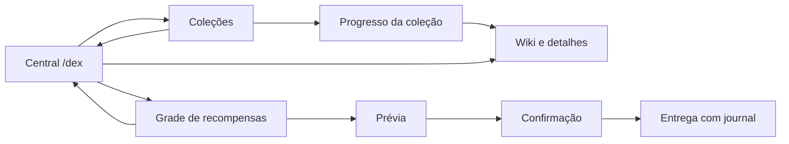

# Layout Shirokai — primeira passagem

Prioridade atual do responsável: melhorar o layout geral antes de avançar nos demais sistemas. `/dex` abre uma central de seis linhas, com título em gradiente, destaques ✦, fundo discreto, resumo real do treinador e atalhos. Coleções continuam em três linhas; wiki em quatro; recompensas agora têm grade paginada em três linhas. Não mudamos os comandos diretos de coleções existentes nem criamos aliases que possam mascarar IDs personalizados.

| Botão da central | Slot padrão (base zero) | Estado |
|---|---:|---|
| Resumo do treinador | 4 | Nome e progresso oficial; informativo |
| Pokédex | 20 | Seletor de coleções autorizadas |
| Recompensas | 22 | Grade/páginas/prévia/confirmação |
| Wiki | 24 | Coleção nacional, se autorizada |
| Competições | 29 | Em desenvolvimento, sem ação |
| Conquistas | 31 | Em desenvolvimento, sem ação |
| Histórico | 33 | Em desenvolvimento, sem ação |
| Preferências | 40 | Em desenvolvimento, sem ação |
| Voltar ao menu externo | 48 | `/menu` como jogador, se registrado |
| Fechar | 50 | Fecha a interface |

O resumo não inventa dinheiro, capturas, rankings ou placeholders externos. “Marco desbloqueado” é um marco observado, não uma declaração de que já foi/será entregue; journal continua controlando o resgate. Áreas sem sistema pronto são explicitamente desativadas. O retorno interno “Central Shirokai” é diferente do botão externo VOLTAR AO MENU.

```json
"home": {
  "rows": 6,
  "palette": "VIOLET",
  "slots": {"dex": 19}
}
```

Opções: VIOLET (padrão), OCEAN, EMBER. rows aceita 3..6; posições omitidas herdam padrões. Para reduzir linhas, reposicionar todos os botões que sairiam do tamanho. IDs desconhecidos, posições duplicadas/fora da grade, campos duplicados e comandos arbitrários no layout são rejeitados integralmente; reload mantém estado/backup válido. Configuração antiga sem home continua válida.

Botões/decoração não transferem itens ao inventário; callbacks verificam permissões atuais. /menu usa a fonte do próprio jogador sem elevar permissão; se o comando não existir, o botão informa indisponibilidade e não executa um comando presumido.

## Navegação atual



Esta é a primeira passagem, não a conclusão de todos os layouts JSON do prompt. Próximo bloco: harmonizar páginas de progresso, wiki/detalhes/formas/spawn e prévia/confirmação; revisar ícones/lore e espaço; incluir estado real de resgate na apresentação e melhorar perfil/placeholder quando houver integração. Evitar retomar moeda/Crates/competições antes dessa revisão visual, conforme prioridade do usuário.

[Evidência de protocolo](validation/layout-home.json). Gradientes/slots/navegação foram validados no protocolo; aparência final em cliente Minecraft real e carga ainda não certificadas. Probes de teste não integram o JAR distribuído.

## Submenus — segunda passagem local

`MenuStyle` aplica títulos em duas cores, cartões ✦, lore legível e rodapés nas posições livres, preservando controles. A barra de 12 segmentos usa contagem exata e não aparece para dados desconhecidos/vazios; nunca fica cheia antes de 100% real.

Prévia e grade leem estados persistidos via worker SQLite, sem reservar operações. Leituras falhas mostram indisponibilidade e não oferecem resgate. Prévia distingue reserva com plano alterado e permite consultar o UUID completo no chat. Callbacks verificam sessão, tela, configuração e permissões antes de abrir. Os ícones de payload e o item da confirmação preservam componentes próprios. Confirmação inclui resumo e botão verde.

Limites: esta segunda passagem tem testes automatizados e build; sua navegação/renderização ainda precisa de repetição em servidor e cliente gráfico. Evidências de servidor da primeira passagem não certificam estas mudanças. Layouts JSON completos continuam pendentes.

## Navegação JSON dos submenus — alpha.6 local

O campo opcional `menus` em config.json aceita overrides por tela. Sem ele, todas as posições anteriores são mantidas. A paleta continua definida por `home.palette`.

```json
{
  "menus": {
    "rewards": { "footer": false, "slots": { "close": 26, "next": 22 } },
    "wiki": { "slots": { "close": 35 } },
    "reward": { "slots": { "status": 26, "next": 19 } }
  }
}
```

Exemplo de troca: close/next devem ser movidos juntos se ocuparem o destino um do outro. Slots são baseados em zero e restritos às linhas de navegação: de 18 até `rows*9-1`. Sem `rows`, os menus continuam com 27 ou 36 slots. Ícones e callbacks são movidos como conjunto, usando snapshot para não perder dados em trocas. Os slots 0–17 continuam reservados ao conteúdo/prêmios, incluindo confirmação, formas e resumo. `footer:false` remove apenas decoração. Um slot sem ação pode conter vidro decorativo; isso não significa que o resgate está habilitado.

| Tela | Slots padrão configuráveis |
|---|---|
| selector | previous 18, close 22, home 23, next 26 |
| collection | back 18, close 22 |
| wiki | previous 18, filter 19, order 20, search 21, close 22, back 23, clear 24, type 25, next 26, category 27 |
| wiki_types / wiki_categories / wiki_forms | previous 18, close 22, back 23, next 26 |
| wiki_details | back 18, close 22, collection 23 |
| wiki_spawns | previous 18, close 22, back 23, next 26, scope 27 |
| rewards | previous 18, close 22, home 23, next 26 |
| reward | back 18, status 19, previous 20, close 22, claim 24, next 26 |
| confirmation | back 18, close 22 |

Campos/telas/ações desconhecidos, duplicatas, números fracionários, colisões e destinos sobre conteúdo são rejeitados na configuração inteira. Falha de reload preserva layout ativo e backup anterior. Não aceita comandos executáveis. Controles que não se aplicam à página/estado permanecem sem ação. Permissões, confirmação e regras de entrega continuam verificadas pelo sistema original.

Capacidade por página e controles dentro da área de conteúdo permanecem fixos. Tamanhos/títulos/paletas/ícones são personalizáveis na extensão alpha.7 abaixo. Aparência em cliente gráfico ainda não certificada. Fixture completa em `tests/fixtures/submenus/config.json`.

## Aparência e tamanho por tela — alpha.7 local

Cada entrada de `menus` também aceita `rows`, `title`, `palette` e `buttons`. Exemplo parcial para mesclar em config.json:

```json
{
  "menus": {
    "reward": {
      "rows": 6,
      "title": "{player} | {title}",
      "palette": "EMBER",
      "slots": { "status": 49, "claim": 52, "close": 53 },
      "buttons": {
        "status": {
          "icon": "minecraft:compass",
          "name": "Estado • {name}",
          "lore": ["Treinador: {player}"]
        },
        "claim": { "icon": "minecraft:emerald", "name": "{name} agora" }
      }
    }
  }
}
```

- `rows`: 3–6 para telas originalmente de 3 linhas; 4–6 para wiki e suas subpáginas. A área dinâmica 0–17 e sua paginação continuam iguais, sem aumento artificial de capacidade. Espaço adicional recebe navegação/borda. Confirmação mantém prêmio/confirmar/resumo nos slots 11/13/15.
- `title`: até 160 caracteres, com `{title}` (título dinâmico original) e `{player}`. Vazio mantém o original. Tokens desconhecidos, controles e chaves malformadas são rejeitados. Expansão não reinterpreta tokens contidos nos valores dinâmicos.
- `palette`: VIOLET/OCEAN/EMBER por tela; ausente herda `home.palette`. Afeta título e borda. Estados de resgate mantêm suas cores semânticas.
- `buttons`: somente ações conhecidas de navegação dessa tela, antes de mover slots. `icon` exige ID registrado e diferente de air. `name`, quando fornecido, deve incluir `{name}` para preservar ação/estado real. `lore` acrescenta até 8 linhas de até 160 caracteres, sem apagar requisitos, situação ou código da operação. Nome/lore aceitam `{name}` e `{player}`.
- Customizar um botão ausente não o cria. Em resgates bloqueados ou encerrados, a aparência `claim` permanece sem ação. Prêmios/componentes/conteúdos exibidos não recebem templates de navegação.

Não interpreta comandos, MiniMessage nem placeholders externos. Paletas oferecem coloração em duas cores nos submenus e gradiente na grade; o título dinâmico original pode manter paginação via `{title}`. A central continua usando seu layout `home`.

Fixture completa: `tests/fixtures/menu-appearance/config.json`. Templates reutilizáveis, condições genéricas e posicionamento arbitrário de conteúdos continuam pendentes; os estados/permissões atuais são condições fixas do servidor. Validação visual em cliente gráfico/carga não certificada.
